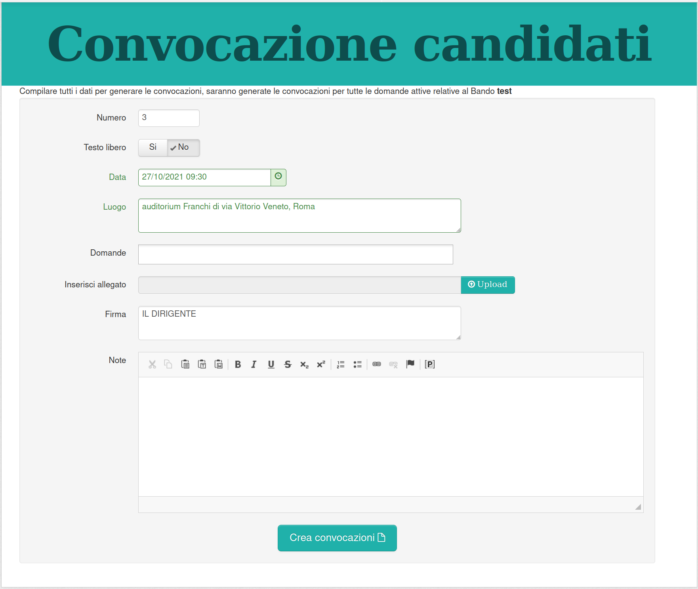
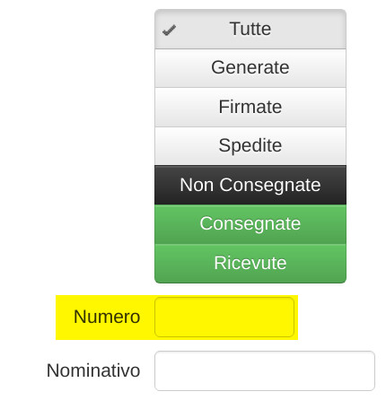
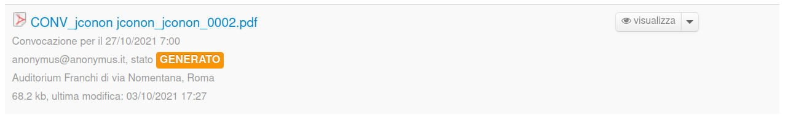
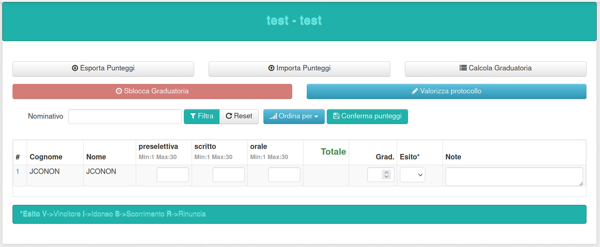
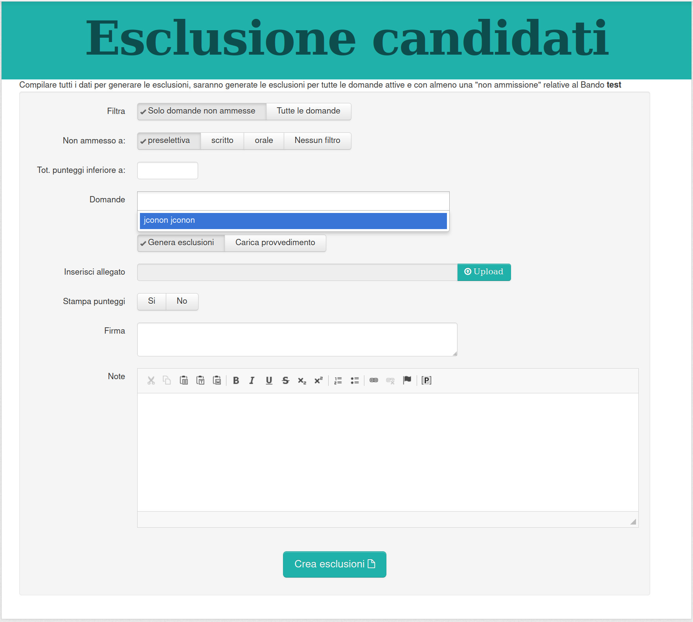
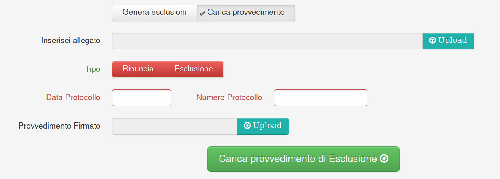
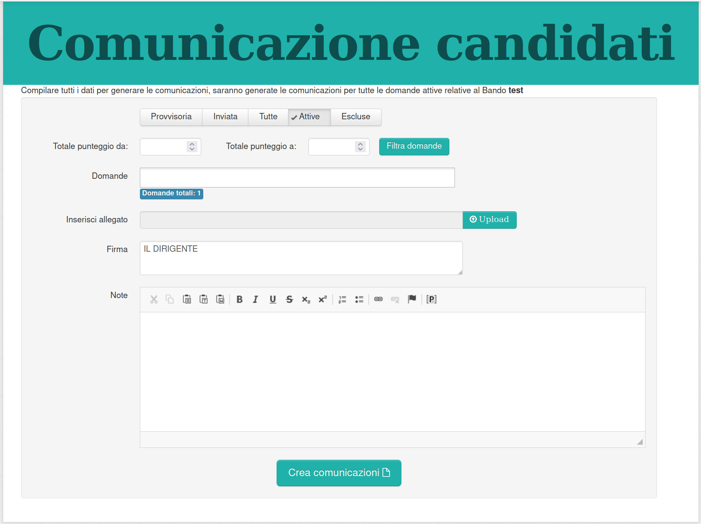

============================================
Gestione delle comunicazioni con i candidati
============================================

Jconon permette di inviare ai candidati 3 tipi di messaggi, *Convocazioni*, *Esclusioni* e *Comunicazioni*. Le modalità di invio sono comuni e prevedono la generazione del messaggio, la firma (passaggio di recente divenuto opzionale) e l'invio. Le voci relative alla generazione e l'invio delle tre tipologie si trova nel menu del bando:

-----------------------------------------
Generazione del messaggio di Convocazione
-----------------------------------------

Il messaggio si genera dal menu del bando, scegliendo "*Convocazioni*"->"*Genera*".
I campi testo obbligatori sono "**Data**" e "**Luogo**" della convocazione, inoltre è possibile selezionare i singoli destinatari, filtrando il campo "Domande".  Il campo relativo al testo libero riguarda la stampa dei punteggi nel pdf: se attivo non vengono stampati.

E' prevista la possibilità di inserire un allegato e di valorizzare il campo firma presente nel testo del messaggio.
Il sistema genera un PDF per ogni candidato che può essere visualizzato, aggiornato, eliminato oppure modificato nella valorizzazione della data e del numero di protocollo.

Nell'elenco dei messaggi, a sinistra, è possibile cercare tra le convocazioni, per numero, oppure per nominativo (il campo è a compilazione assistita).

----------------------------------
Firma dei messaggi di Convocazione
----------------------------------

Una volta generati i documenti PDF, il sistema si posiziona nella pagina dell'elenco dei messaggi, dove è possibile firmarli digitalmente (nella sola modalità PAdES), tramite l'utilizzo di una firma remota Aruba. Si veda la `guida apposita`_ per la configurazione corretta dei parametri. Cliccando "*Firma convocazioni*" si apre la maschera di inserimento delle credenziali e dell'OTP: il sistema firma massivamente le convocazioni.

----------------------------------
Invio dei messaggi di Convocazione
----------------------------------

Una volta firmate le convocazioni, si clicca "**Invia convocazioni**" e si inseriscono i parametri di login di un account PEC possibilmente dedicato ai concorsi (non mail ordinaria), e si sceglie a quale indirizzo inviare i messaggi. In questo passaggio si deve tenere presente che: 

 * se il candidato ha presentato un indirizzo PEC, il sistema provvede in autonomia a recuperare le ricevute di accettazione e di avvenuta consegna, mostrando a video la ricezione del messaggio verso il candidato.
 * se il candidato ha presentato un indirizzo mail ordinario, nel corpo del messaggio compare un testo dove si invita il candidato a cliccare un link per confermare l'avvenuta ricezione.

Il documento PDF viene depositato nello spazio personale del candidato e può essere sempre reperito dallo stesso entrando con le sue credenziali ed andando nella sezione "**Le mie domande**".

Qualora sia configurato un servizio nel sistema io.italia.it, viene inviata anche una notifica tramite APP IO al Codice Fiscale presente nella domanda con il link alla convocazione nello spazio personale del candidato.

---------------------------------------
Generazione del messaggio di Esclusione
---------------------------------------
Questa sezione si utilizza dopo la valorizzazione dei voti nella sezione "Punteggi", di cui si riporta un esempio:

Il messaggio si genera dal menu del bando, scegliendo "*Esclusioni*"->"*Genera*". 
L'obiettivo di questa sezione è di agevolare la Commissione nel filtrare i destinatari delle esclusioni nelle varie prove. L'interfaccia infatti presenta la possibilità di selezionare le sole domande dichiarate non ammissibili, oppure quelle i cui candidati non abbiano superato una determinata prova, tra quelle inserite nella :doc:`configurazione del bando<configurazione_bandi>`.

Nell'esempio sopra, il candidato "Jconon" ottiene un punteggio pari a 6 nella prova preselettiva ed il minimo per passare è 21. Nell'immagine si vede che il sistema filtra automaticamente la sua domanda. Questa funzione è utilizzabile per ogni prova. 

E' possibile infine gestire anche il caricamento dei provvedimenti ad hoc, di *Rinuncia* o di *Esclusione*.

--------------------------------
Firma dei messaggi di Esclusione
--------------------------------

Una volta generati i documenti PDF, il sistema si posiziona nella pagina dell'elenco dei messaggi, dove è possibile firmarli digitalmente (nella sola modalità PAdES), tramite l'utilizzo di una firma remota Aruba. Si veda la guida apposita per la configurazione corretta dei parametri. Cliccando "*Firma esclusioni*" si apre la maschera di inserimento delle credenziali e dell'OTP: il sistema firma massivamente le esclusioni.

--------------------------------
Invio dei messaggi di Esclusione
--------------------------------

Una volta firmate le esclusioni, si clicca "**Invia esclusioni**" e si inseriscono i parametri di login di un account PEC possibilmente dedicato ai concorsi (non mail ordinaria), e si sceglie a quale indirizzo inviare i messaggi. In questo passaggio si deve tenere presente che: 

 * se il candidato ha presentato un indirizzo PEC, il sistema provvede in autonomia a recuperare le ricevute di accettazione e di avvenuta consegna, mostrando a video la ricezione del messaggio verso il candidato.
 * se il candidato ha presentato un indirizzo mail ordinario, nel corpo del messaggio compare un testo dove si invita il candidato a cliccare un link per confermare l'avvenuta ricezione.

Il documento PDF viene depositato nello spazio personale del candidato e può essere sempre reperito dallo stesso entrando con le sue credenziali ed andando nella sezione "**Le mie domande**".

Qualora sia configurato un servizio nel sistema io.italia.it, viene inviata anche una notifica tramite APP IO al Codice Fiscale presente nella domanda con il link all'esclusione nello spazio personale del candidato.

------------------------------------------
Generazione del messaggio di Comunicazione
------------------------------------------
Questa sezione si utilizza dopo la valorizzazione dei voti nella sezione "Punteggi", a cui si rimanda.

Il messaggio si genera dal menu del bando, scegliendo "*Comunicazioni*"->"*Genera*". 
L'obiettivo di questa sezione è di agevolare la Commissione nel filtrare i destinatari delle comunicazioni di superamento delle varie prove. L'interfaccia infatti presenta la possibilità di selezionare tra i vari stati delle domande (Provvisorie, Inviate, Attive, Tutte, Escluse) oppure tra i candidati che abbiano ottenuto un determinato range di punteggio.

Nella nuova interfaccia il campo **Note** delle comunicazioni (come quello di convocazioni ed esclusioni generate
dalla stessa pagina) accetta testo formattato (grassetto, corsivo, elenchi, link) e **segnaposto**: dal menu
"Inserisci un segnaposto…" si sceglie un campo della domanda o del bando e il pulsante **Inserisci** aggiunge nel testo
``[[nome del campo]]``, che al momento della generazione viene sostituito con il valore di ciascun candidato o del bando.

-----------------------------------------
Invio della graduatoria privata
-----------------------------------------

Selezionando la casella **Graduatoria privata** la maschera richiede la **data** e il **numero di protocollo** del
documento e il documento stesso (il numero viene completato a 7 cifre con gli zeri iniziali). Il documento allegato,
oltre a essere inviato ai candidati selezionati insieme alla comunicazione, viene registrato automaticamente nella
sezione *Allegati* del bando con la tipologia **Graduatoria privata del Bando di concorso**, con data e numero di
protocollo, in modalità privata: è visibile e gestibile solo dal gruppo CONCORSI e dal Responsabile del Procedimento
del bando e non compare tra gli allegati generici né nella pagina pubblica del bando.

Se la casella è selezionata ma mancano data, numero di protocollo o documento, la generazione non viene effettuata e
viene mostrato il relativo messaggio. Nell'estrazione Excel dei bandi sono presenti le colonne
"Graduatoria privata - Num. Protocollo" e "Graduatoria privata - Data Protocollo".

-----------------------------------
Firma dei messaggi di Comunicazione
-----------------------------------

Una volta generati i documenti PDF, il sistema si posiziona nella pagina dell'elenco dei messaggi, dove è possibile firmarli digitalmente (nella sola modalità PAdES), tramite l'utilizzo di una firma remota Aruba. Si veda la guida apposita per la configurazione corretta dei parametri. Cliccando "*Firma comunicazioni*" si apre la maschera di inserimento delle credenziali e dell'OTP: il sistema firma massivamente le comunicazioni.

-----------------------------------
Invio dei messaggi di Comunicazione
-----------------------------------

Una volta firmate le comunicazioni, si clicca "**Invia comunicazioni**" e si inseriscono i parametri di login di un account PEC possibilmente dedicato ai concorsi (non mail ordinaria), e si sceglie a quale indirizzo inviare i messaggi. In questo passaggio si deve tenere presente che: 

 * se il candidato ha presentato un indirizzo PEC, il sistema provvede in autonomia a recuperare le ricevute di accettazione e di avvenuta consegna, mostrando a video la ricezione del messaggio verso il candidato.
 * se il candidato ha presentato un indirizzo mail ordinario, nel corpo del messaggio compare un testo dove si invita il candidato a cliccare un link per confermare l'avvenuta ricezione.

Il documento PDF viene depositato nello spazio personale del candidato e può essere sempre reperito dallo stesso entrando con le sue credenziali ed andando nella sezione "**Le mie domande**".

Qualora sia configurato un servizio nel sistema io.italia.it, viene inviata anche una notifica tramite APP IO al Codice Fiscale presente nella domanda con il link alla comunicazione nello spazio personale del candidato.

.. _Sezione 4: https://github.com/consiglionazionaledellericerche/cool-jconon/blob/master/docs/configurazione_bandi.rst
.. _guida apposita: https://github.com/consiglionazionaledellericerche/cool-jconon-template/blob/master/setup.md

----------------------------------------------
Nella nuova interfaccia: firma, invio e azioni
----------------------------------------------

* La **firma** chiede sempre utente, password e OTP; con **Firma automatica** gli stessi campi sono le credenziali
  del servizio di firma automatica (utente, password e PIN/codice). La dicitura della firma è quella dell'utente
  collegato.
* La firma è **facoltativa**: l'invio comprende sia i documenti firmati sia quelli solo generati, con un avviso sul
  numero di documenti che partiranno senza firma digitale.
* Su ciascun documento sono disponibili **visualizza** (metadati), **scarica**, **modifica** (ad esempio data e numero
  di protocollo), **aggiorna** (nuovo contenuto del documento) ed **elimina** (solo se non ancora spedito).

--------------------------------------------
Messaggi al singolo candidato e notifiche
--------------------------------------------

Esclusioni, riammissioni, rinunce, comunicazioni e convocazioni per il singolo candidato si gestiscono anche dal menu
**Operazioni** della domanda (vedi :doc:`Operazioni sulle domande<operazioni_domande>`).

All'invio di convocazioni, comunicazioni ed esclusioni, i candidati che hanno attivato le notifiche dell'app ricevono
anche una notifica sul proprio dispositivo (vedi :doc:`App e notifiche<app_notifiche>`).

-----------------------------------------------------------
Stato dei messaggi di Convocazione Comunicazione Esclusione
-----------------------------------------------------------

Gli Stati dei messaggi al candidato sono i seguenti:

    - **GENERATO** Il messaggio è stato generato ed è visibile solo al Responsabile che ha provveduto a generarlo e non è visibile al candidato destinatario della stesso.
    - **FIRMATO** Il messaggio è stato firmato con firma digitale, lo stesso è ora visibile al candidato tra gli allegati della sua domanda di concorso.
    - **SPEDITO** Il messaggio è stato spedito al candidato ed è in attesa di una ricevuta, se il messaggio si trova in questo stato il candidato potrebbe non averlo ancora ricevuto.
    - **NON CONSEGNATO** Il messaggio non è stato recapitato via PEC dove è arrivata una notifica di non ricezione, il responsabile può controllare la PEC di invio per verificare il problema.
    - **CONSEGNATO** Il messaggio è stato recapitato via PEC dove è arrivata una notifica di ricezione avvenuta.
    - **RICEVUTO** Il messaggio è stato recapitato al candidato che nè ha dato conferma di ricezione attraverso il link presente nel messaggio stesso.
